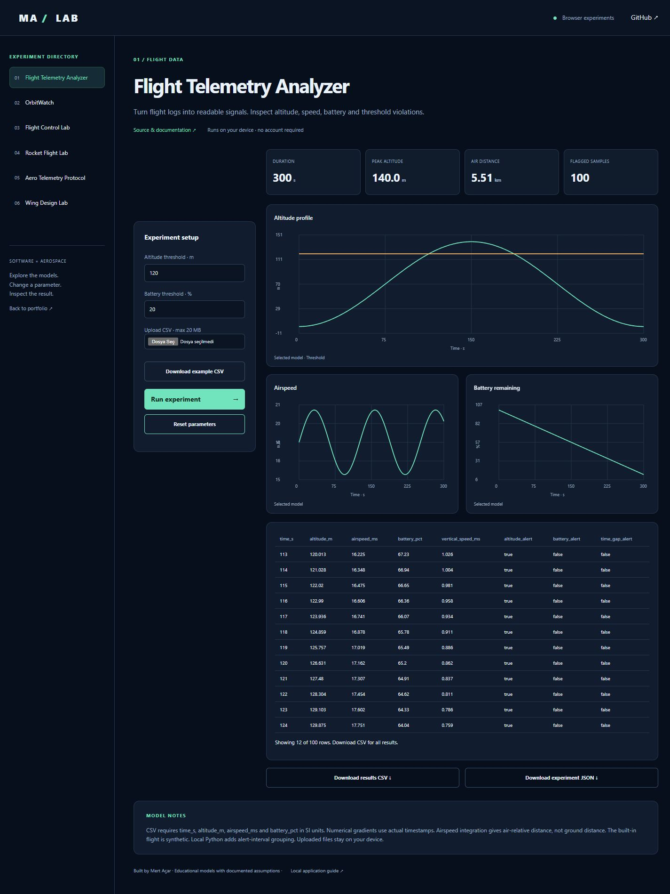

# Flight Telemetry Analyzer

[Live browser demo](https://mertacar-git.github.io/flight-telemetry-analyzer/) · [Portfolio laboratory](https://mertacar-git.github.io/portfolio/lab/index.html?project=flight-telemetry-analyzer)

<details>
<summary>Actual application screenshot</summary>



</details>

[Short demo video](docs/demo.mp4) — a timed walkthrough of actual default and changed-parameter screenshots.

## Browser and local editions

The public browser demo runs JavaScript models on-device. The local application uses Python and Streamlit. JavaScript numerical/protocol outputs are checked against committed Python reference fixtures. Satellite.js 6.0.1 is bundled with its license; no runtime CDN is required. Uploaded CSV data is processed locally in the browser.

Browser orbit crossings use sampling and bisection, with sampled culmination times; local Skyfield uses its event search. Browser rocket inputs use constant thrust; local Python also supports uploaded thrust curves. Browser wing coefficients are fixed to CD0=0.025 and CLmax=1.2; local Python exposes these and a span sweep. Browser telemetry has CSV/JSON analysis; local Python additionally groups alert intervals.

```sh
node --test docs/models.test.cjs
```

Serve `docs/` with any static server to run the browser edition locally. Example: `python -m http.server 8000 --directory docs`. Open http://localhost:8000.


Upload flight CSV logs, inspect altitude, airspeed, battery and vertical-speed plots, flag configurable threshold violations and export results.

## Features

- CSV input validation, configurable altitude/battery thresholds and a downloadable example flight.
- Four interactive plots with threshold overlays.
- Air-relative distance from trapezoidal integration and time-weighted average speed.
- Consecutive alert intervals, time-gap detection and raw-data inspection.
- Analyzed CSV and summary JSON downloads.

## Example workflow

Start the app to see a synthetic flight. Set the altitude threshold to 120 m and battery threshold to 20%. Open **Alerts & quality** to inspect the flagged intervals. Upload `sample_flight.csv` to exercise the same flow with a file. Export the resulting report.

Input units are seconds, meters, meters/second and percent. Extra columns are ignored. Input is limited to 20 MB. Airspeed integration estimates air-relative travel, not a ground track. Battery used is a difference in percentage points; recharging logs can produce negative usage. Numerical derivatives around data gaps need careful interpretation.

## Quick start

Python 3.12 recommended. Run commands inside this repository.

```sh
python -m venv .venv
# Windows:
.venv\Scripts\activate
# macOS/Linux: source .venv/bin/activate
python -m pip install -r requirements.txt
python -m streamlit run app.py
```

## Validation

```sh
python -m unittest discover -v
```

## Model and limitations

Required CSV columns: `time_s`, `altitude_m`, `airspeed_ms`, `battery_pct`. Time must strictly increase; values must be finite. Battery is 0–100 percent. Vertical speed uses a numerical gradient on actual sample timestamps. The built-in flight is synthetic. Thresholds are user-defined and are not regulatory limits.

## Repository structure

- `core.py`: numerical/data processing functions
- `app.py`: interactive Streamlit interface
- `test_core.py`: checks for model behavior and invalid input

## Development

Built with AI assistance. Model assumptions and validation are documented so the implementation can be reviewed and extended.

## Checks and license

GitHub Actions runs core and Streamlit interaction tests on every push and pull request. The UI tests cover offline operation and primary controls. External data-service availability is not guaranteed by offline tests. MIT licensed; see `LICENSE`.
